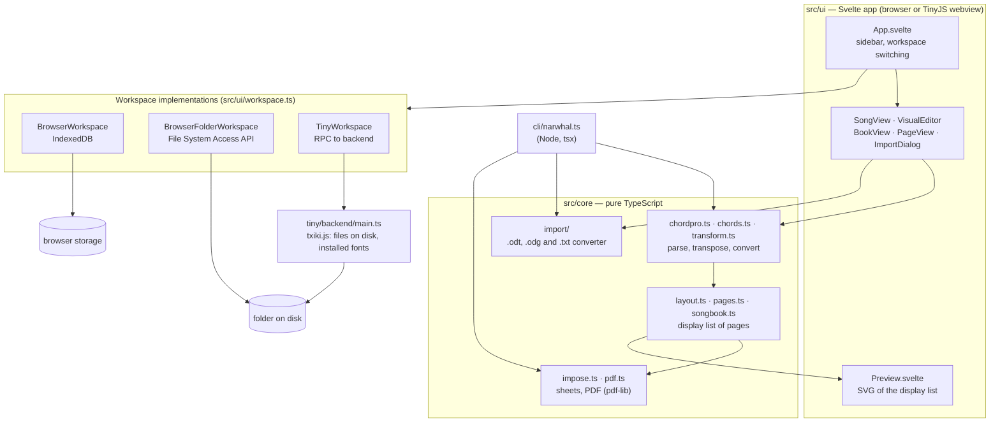

# Technical overview

How Singing Narwhal is built, how it stores files, and how it is distributed. For using the
app, see the [README](../README.md); for working on the code, see the
[developer guide](DEVELOPMENT.md).

## Architecture

One TypeScript codebase runs in three places: the browser, a TinyJS desktop app and the
command line. Everything that understands songs and draws pages is in `src/core/`, plain
TypeScript with no browser or Node dependencies. The UI and the CLI are thin layers on
top, and files are reached through a small `Workspace` interface with one implementation
per kind of storage.



### Rendering pipeline

```
 .cho ──parse──▶ SongDoc ──layout──▶ pages (display list) ──┬──▶ SVG preview
                                       ▲                    └──▶ impose ──▶ PDF (pdf-lib)
 .songbook.yaml ──────── assemble ─────┘   (index, page numbers, blanks, images, pages)
 .page.yaml ──────────── layoutPage ───┘
```

- **Parsing** (`chordpro.ts`) keeps one entry per source line, so a song can be edited and
  written back without losing anything. Chords are stored as positions in the lyric text,
  which is what keeps them anchored to letters while the text changes.
- **Layout** (`layout.ts`) measures text with the real font files (fontkit) and produces a
  *display list*: positioned text, lines, rectangles and images per page. Chords that would
  collide are spaced out (with a hyphen when a word is split), long lines wrap,
  paragraphs are kept together. Auto-fit tries one and two columns and text scales from
  100% down to 75%, and keeps the result with the fewest pages, then the largest text with
  the fewest wrapped lines.
- **Assembly** (`songbook.ts`) lays out each item of a songbook, starts 2-page songs on a
  left page, numbers pages on the outer corners, builds the index once page numbers are
  known, and pads booklets to a multiple of 4 before a final back cover.
- **Imposition** (`impose.ts`) places pages on sheets: one per sheet, two copies per sheet,
  two pages per sheet, or saddle-stitch booklet order.
- **Output:** the preview draws the display list as SVG, and `pdf.ts` draws the same list
  into a PDF with embedded font subsets. Both come from the same data, so the preview
  matches the printout.

### Import pipeline

`src/core/import/` turns "chords on the line above the lyrics" into ChordPro:

1. **Read** the document into lines of characters with x-positions. For `.odt`
   (`odt.ts`, unzipped with fflate, parsed with a small XML reader in `xml.ts`), styles,
   spaces, tabs and indents are resolved and every character is measured with the
   closest bundled font; for `.txt` (`index.ts`), columns are monospaced.
2. **Convert** (`sheet.ts`): classify chord lines and lyric lines, attach each chord to
   the letter under it (moving it to the next word if it sits on a space), and recognise
   titles, artists, instrumental lines, indented choruses, `Rit.` labels and chorus repeats.

**Songbooks from LibreOffice Draw** (`odg.ts`). Each landscape sheet is split into its two
halves, numbered as a booklet (n|1, 2|n−1, …) or in reading order, as the user chooses.
A half holding an embedded text document becomes a song, read by the `.odt` reader; a half
with text boxes, rounded rectangles and pictures becomes a page (`.page.yaml`), stacked
from top to bottom with the original gaps, a text box inside a rectangle becoming the box's
label; an empty half becomes a blank page. The import dialog assembles them into a
`.songbook.yaml` and converts GIF pictures to PNG (in the browser), since the PDF writer
embeds only PNG and JPEG.

### Import dialog

`src/ui/ImportDialog.svelte` is the only way in from outside the workspace. Single files
are converted if needed and put in `songs/`, `pages/`, `images/`, `fonts/` or the top
folder, with a new name rather than replacing a file. A folder (`filesFromFolder`: the
desktop app reads it through the backend, browsers use a `webkitdirectory` input, which
works in Safari and Firefox too), a dropped folder (`webkitGetAsEntry`) or a `.zip`
(`filesFromZip`: a single top-level folder, as made by the Finder, is removed) is a
*project*: its songs, pages, songbooks, images and fonts keep their paths, so songbooks
still find what they list, and replace files with the same path (marked in the list);
`.odt`, `.txt` and `.odg` files in it are converted; dotfiles, `__MACOSX` and other files
are skipped. After each addition the dialog lists what the songbooks and pages to import
use but neither they nor the workspace have. Nothing is written until **Done**.

### Installed fonts

Besides the bundled fonts and the workspace's `fonts/`, the app can use the fonts installed
on the computer: always in the desktop app, and in Chrome and Edge through the Local Font
Access API (`queryLocalFonts`, after the user clicks **Use fonts installed on this
computer** and allows it; later visits reuse the permission). Safari and Firefox don't
implement that API.

- **Listing.** The desktop backend walks `~/Library/Fonts`, `/Library/Fonts` and
  `/System/Library/Fonts` (and the usual Linux folders) and reads only each file's table
  directory, `name` table and OS/2 flags (`sfnt.ts`, with positioned reads): about 900
  faces in 0.2–1.5 s on a Mac, once per session. In the browser, `queryLocalFonts`
  returns the names directly.
- **Which fonts.** Faces whose licence flags (OS/2 `fsType`) forbid embedding are left out,
  as are variable fonts (pdf-lib's subsets of them lose glyphs), colour bitmap fonts and
  hidden system fonts (names starting with `.`). The browser can't check this before
  reading a font, so it checks when the font is first used and reports the error.
- **Ids.** An installed face gets an id in the registry's style from its family and style
  names (name IDs 1 and 2): Georgia Bold Italic → `Georgia-BoldItalic`; styles other than
  regular, bold and italic become part of the family (Avenir Next Medium Italic →
  `AvenirNextMedium-Italic`). Bundled and workspace fonts win over installed fonts with the
  same id.
- **Loading on demand.** `FontRegistry.offer` adds the list without reading any font.
  Layout asks for fonts through `loadedFont` / `resolve`, which start loading an installed
  font and use Liberation Serif in the same style until it is ready; the registry then
  calls back, and the app replaces its `fonts` with `fonts.copy()` (same fonts, new
  object) so the editors lay out again. PDF export first waits for loading fonts
  (`fonts.idle()`).
- **Collections.** A `.ttc` holds several faces that pdf-lib can't embed as a whole, so
  `extractFace` copies one face's tables into a standalone font, in the backend for the
  desktop app and in the page for Chrome (where the font data may be a whole collection;
  the face is found by its PostScript name).

A songbook or page keeps the id of the installed font it uses. Where that font is missing,
the picker shows it as *(not available)* and the text is laid out in Liberation Serif.

## Technologies

| Area | Choice | Why |
|---|---|---|
| Language | TypeScript | one codebase for browser, desktop and CLI |
| UI | Svelte 5 (runes) | small bundle, approachable code for contributors |
| Build | Vite | fast dev server; builds a static site with relative paths |
| PDF | pdf-lib + @pdf-lib/fontkit | PDFs generated in the app, fonts embedded, no server or native code |
| Zip and `.odt` | fflate | unzips `.odt`, makes and reads `.zip` backups |
| Songbooks and pages | YAML (`yaml`) | readable and editable by hand |
| Songs | ChordPro | existing plain-text format that already anchors chords to letters |
| Desktop | TinyJS (system WebKit + txiki.js backend) | about 6 MB, no Electron |
| CLI | Node + tsx | runs the TypeScript sources directly |
| Tests | Vitest | unit tests of `src/core` |
| Fonts | Liberation Serif, Sans, Mono (SIL OFL) | LibreOffice's defaults, metric-compatible with Times New Roman, Arial and Courier, so imported documents measure exactly |
| More fonts | Crimson Text, Courier Prime, Atkinson Hyperlegible (SIL OFL) | a book serif, a typewriter face for chords, a very legible sans; small static files (about 1.4 MB together) |

## File formats

A workspace is a plain folder:

```
canzoniere/
  campo-2026.songbook.yaml
  pages/
    copertina.page.yaml
  songs/
    aquile-randagie.cho
    strade-di-coraggio.cho
  images/
    logo.png
  fonts/                  # optional: extra .ttf/.otf fonts, usable in pages
    Amatic-Bold.ttf
```

Keep songbooks at the top of the workspace: the paths inside them are relative to the
songbook file. All files are UTF-8 text except images and fonts.

### Songs: ChordPro (`.cho`)

[ChordPro](https://www.chordpro.org/), with chords inline in square brackets right before
the letter they belong to:

```
{title: Aquile Randagie}
{artist: Cisco Bellotti}
{key: D}

[D]Siamo Aquile ran[G]dagie
che [A]volano in alto nel [D]cielo

{start_of_chorus}
[A]Estote parati, estote parati
è il [Bm]grido che abbiamo in gola
{end_of_chorus}

{chorus}

Intro: [D] [G] (2x)
```

| Syntax | Meaning |
|---|---|
| `[Am]` before a letter | chord on that letter; English or Italian names (`Am`, `Lam`, `La-`, `LA-`) |
| a line with no lyrics, only chords, a `Label:`, `(notes)` and symbols (`\|`, `x2`) | instrumental line, chords printed inline |
| `{start_of_chorus}` … `{end_of_chorus}` | chorus (indented); also `verse`, `bridge`, `tab` |
| `{start_of_chorus: Rit.}` | chorus with a label in the margin |
| `{chorus}` | repeat the last chorus: prints its first line + "…" |
| `{comment: …}` | italic note |
| `{column_break}`, `{new_page}` | force a break |
| `{columns: 2}` | number of columns for this song (songbooks may override it) |
| `# …` | comment line, not printed |

Unrecognised chords (`N.C.`, `|`, `x2`) are printed as written and never transposed.
Converting the notation or transposing rewrites the chords in the file. Minor chords keep
the sign they were written with (`Lam` → `Sim`, `La-` → `Si-`); converting to Do Re Mi
writes `Am` as `Lam`, and converting to C D E writes `Lam` and `La-` as `Am`.
Transposition spells accidentals for the new key (D+1 → E♭, not D♯), using `{key}`.

### Songbooks (`.songbook.yaml`)

```yaml
title: Canzoniere Campo 2026
page: A5               # A4 | A5 | A6 | Letter | "Half Letter"
imposition: booklet    # booklet | 2up | single | copies
notation: original     # original (chords as written) | italian | english
columns: auto          # auto | 1 | 2
style:                 # optional, only what differs from the defaults
  lyrics: { size: 11 }
  chords: { size: 9.5 }
contents:
  - page: pages/copertina.page.yaml
  - toc: Indice
  - song: songs/al-fuoco-di-bivacco.cho
  - song: songs/insieme.cho
    columns: 2
  - blank
  - image: images/foto.jpg          # full-page image
  - page: pages/citazione.page.yaml # last page = back cover
```

Other options: `show_chords`, `page_numbers`, `keep_spreads` (start 2-page songs on a
left page), `fold_line`. A `page` item accepts `page_number: true` to number that page.

### Pages (`.page.yaml`)

Non-song pages (cover, quote, notes, ruled pages): a list of elements stacked from top to
bottom. A height of `fill` shares the space left on the page.

```yaml
elements:
  - text: "{{title}}"            # placeholders: {{title}}, {{year}}, {{date}}
    font: LiberationSans-Bold    # a bundled font, a font from fonts/ or an installed font
    size: 34
    align: center
  - image: images/logo.png
    height: fill
  - box: "Nome:"                 # rounded box with a label
    height: 46
    radius: 10
```

| Element | Options |
|---|---|
| `text` | `font`, `size`, `align`, `line_height`, `indent` |
| `image` | `height` (pt or `fill`), `width` (fraction of the page width), `align` |
| `box` | label; `height`, `radius`, `line_width`, `font`, `size`, `align` |
| `lines` | number of ruled lines or `fill`; `spacing` |
| `space` | height in points, or `fill` |
| `rule` | horizontal line; `line_width` |

All elements except `space` accept `margin` (space above, in points). New pages start
from built-in templates (`starterTemplate` in `pages.ts`). `{{title}}` is replaced with the
title of the songbook the page is printed in.

## Storage

All file access goes through the `Workspace` interface (`src/ui/workspace.ts`): `list`,
`readText`, `readBytes`, `writeText`, `writeBytes`, `remove`, `rename`. Paths are relative
to the workspace root with `/` separators.

| Implementation | Used by | Where files are | Notes |
|---|---|---|---|
| `TinyWorkspace` | desktop app | a folder on disk | each call goes to `tiny/backend/main.ts` over TinyJS's RPC (`tiny.api.call`); paths containing `..` are refused |
| `BrowserFolderWorkspace` | website in Chrome/Edge | a folder on disk | File System Access API (`showDirectoryPicker`); needs HTTPS or localhost |
| `BrowserWorkspace` | website, by default | IndexedDB | empty on first use |
| `NoWorkspace` | startup | nowhere | placeholder until the real workspace is open; refuses writes |

### Browser storage (IndexedDB)

- Database `narwhal-db` (`src/ui/idb.ts`) with two stores: `files` (path → bytes) and
  `meta` (backup times, the remembered folder handle, a "seeded" flag marking that the one-time setup ran).
- All files are loaded into memory when the workspace opens; reads are served from
  memory. A write resolves only after the IndexedDB transaction commits, and **throws** if
  the browser refuses it, so the app never reports a failed save as saved.
- The database is at version 2, which adds no data: upgrading re-runs the setup, which
  creates any missing store (Firefox was seen with a version-1 `narwhal-db` that had none).
  Open connections close on `versionchange`, so a newer app in another tab can upgrade.
- If the browser's storage fails or does not answer within 8 seconds at startup (e.g. an
  old tab blocks the upgrade), the app keeps the session in memory, says why in the error
  bar, and still offers Import and Download.
- When it opens, the workspace checks `navigator.storage.persisted()` in the background. If the data is not
  protected yet, the first write of a session calls `navigator.storage.persist()`, asking
  the browser not to evict it under storage pressure. While protection is granted the
  sidebar says "Protected from automatic deletion". The Safari 7-day warning stays: Apple
  does not document whether persistence exempts a site from it.
- Earlier versions used `localStorage`, then a database named `narwhal-score`; their data
  is moved to `narwhal-db` once, and the old storage is removed.
- Without IndexedDB (some private windows), files are kept in memory only and the sidebar
  says so.
- The data belongs to one origin (scheme + host + port). Sites under a shared origin,
  such as several projects on `username.github.io`, share it: serve the app from its own
  domain or subdomain.

**Lifetime.** Data survives reloads and browser restarts. It is deleted by private-window
closing, by clearing site data, by Safari after 7 days without a visit
(Intelligent Tracking Prevention), and possibly by eviction when the disk is full and
persistence was not granted.

**Backups.** `BrowserWorkspace` records the time of the last change and the last backup
(a `.zip` download or a copy to a folder) in `meta`; the sidebar shows them. Importing
the `.zip` restores a backup (see *Import dialog*).

### Folders in the browser

The handle of the folder picked with **Open folder…** is stored in IndexedDB. At startup
the app asks the browser whether permission is still granted (`queryPermission`); if so it
reopens the folder directly, otherwise it shows **Reopen folder**, which calls
`requestPermission` (this needs a click). **Work in browser storage instead** forgets the
folder.

### Recent folders

Every folder opened, picked or started in is put first in a list of up to 8 recent
folders (`recentFolders` in `src/ui/workspace.ts`), which the sidebar shows without the
current one. The desktop app keeps the paths in `tiny.store` (key `recentFolders`); a path
that no longer exists is reported and dropped when clicked. Browsers keep the folder
handles in IndexedDB (`meta`, key `recentFolders`), compared with `isSameEntry`; opening
one asks for permission again. Removing a folder from the list leaves its files alone.

### Desktop app

The desktop app never uses the webview's own storage. At startup it reads the last folder
from TinyJS's settings store (`tiny.store`, kept in
`~/Library/Application Support/org.narwhal.app/`). If there is none, or it no longer
exists, it creates `<Documents>/SingingNarwhal` (from `tiny.app.paths()`) and uses that.

### Saving

Editors save automatically a moment after the last change (`debouncedSaver` in
`src/ui/saves.ts`) and flush pending saves when they close. Renames and deletes wait for
pending saves, and update the songbooks that refer to the file (`src/ui/fileops.ts`).
Failed saves are reported in a red error bar.

## Distribution

### Website

`npm run build` writes a static site to `dist/` with relative paths (Vite `base: './'`),
so it can be served from any host and any sub-path: GitHub Pages, Netlify, a group's web
space. There is no server code and nothing is uploaded: files stay on the user's computer.

- Serve over **HTTPS**: browsers only allow folder access (File System Access API) in
  secure contexts.
- Prefer a **dedicated origin** (own domain or subdomain), so browser storage is not
  shared with other sites.
- Changing the address later means users' browser storage is left behind at the old one;
  they can move it with **Download all (.zip)** and importing that `.zip`.
- There is no offline mode (no service worker) yet.

### Desktop app (TinyJS)

`tinyjs.json` configures the app (its name in `"title"`, which the web build and the CLI
also read; id `org.narwhal.app`; icon `assets/narwhal-logo.png`; `version`, set by
`npm run release`), the frontend (`npm run build`,
served from `dist/`) and the backend (`tiny/backend/main.ts`, bundled by TinyJS with
esbuild and run by txiki.js).

- The About panel (app menu) shows the version from `tinyjs.json` and the text of
  `assets/Credits.html`, which TinyJS copies into the app's `Resources/`.
- The launcher loads the page from `file://` in the system WebKit. Local reads with
  `fetch` succeed with status 0 there, which the font loader accepts.
- The backend exposes file operations on the workspace folder (list, read, write, rename,
  remove), plus reading and writing files the user picked in native dialogs, and the
  installed fonts (see [Installed fonts](#installed-fonts)).
- `tinyjs.json` registers `.cho`, `.chordpro`, `.odt` and `.odg` with macOS. Files opened
  from Finder or dropped on the Dock icon arrive through `tiny.app.onOpenFiles` (also at
  launch) and open the import dialog once the workspace and fonts are ready.
- `tinyjs build --dmg` produces a `.dmg` in `.build/`. By default it runs only on the CPU
  type of the Mac that built it; it is signed ad-hoc, so macOS warns about an unidentified
  developer unless a Developer ID is configured (`signIdentity`). Updates are not set up yet.

### Command line

`cli/narwhal.ts` renders songs and songbooks to PDF and converts `.odt`/`.txt` files to
ChordPro, using the same `src/core` code with fonts read from `public/fonts/`. See the
[developer guide](DEVELOPMENT.md#command-line).

### Web app and desktop app compared

| | Website | Desktop app |
|---|---|---|
| Storage | IndexedDB, or a folder (Chrome/Edge) | always a folder |
| Data loss risks | private windows, clearing site data, Safari's 7 days, eviction | none from the app |
| Folder access | permission may be asked again on each visit | no prompts; full path shown |
| Dialogs | browser file picker / download | native macOS panels (no suggested file name when saving) |
| Updates | immediate on reload | new `.dmg` |
| Installation | none | `.dmg`; unsigned builds trigger a macOS warning |
| Platforms | any modern browser | macOS (built per CPU type unless configured) |
| Offline | no | yes |
| Installed fonts | Chrome and Edge, after the user allows it | always |

## Licences

The app is GPL-3.0-or-later. Dependencies (pdf-lib, @pdf-lib/fontkit, fflate, yaml,
Svelte) are under MIT, ISC or similar permissive licences, compatible with the GPL. The
bundled fonts (Liberation, Crimson Text, Courier Prime, Atkinson Hyperlegible) are under the
SIL Open Font License 1.1 (`public/fonts/LICENSE-*.txt`). Installed fonts are read from the
user's computer, never distributed with the app; those that forbid embedding are not
offered.
